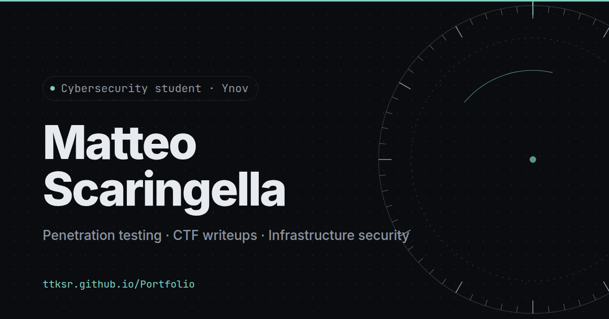

# Matteo Scaringella — Portfolio

Personal portfolio of a cybersecurity student at Ynov: projects, CTF writeups, certifications,
and a small live astronomy lab. Hand-written HTML, CSS and JavaScript, no framework, no build step,
no third-party request.

**Live:** https://ttksr.github.io/Portfolio/



---

## Features

- **Single screen, no scrolling.** Seven panels that swap in place with animated transitions,
  navigable by menu, keyboard (`←` `→`, `0`–`6`), mouse wheel or swipe. Deep links work (`#writeups`).
- **Terminal mode.** Press `t` (or click `>_`): the whole site becomes a shell — `ls`, `cd`, `cat`,
  `open`, zsh-style tab completion with a selectable menu, history. It reads the same content as the page.
- **Session log.** A live, access-log style trace of what the visitor does (`GET /about`,
  `inspect secure-chat.md`), also readable with `cat session.log`.
- **Lab — HD 110067.** A real-time view of six exoplanets, computed from the published transit
  ephemerides (Luque et al. 2023, *Nature* 623). Interactive orbits, transit countdowns and light curves,
  and per-pixel rendered close-ups of each planet and of the star, with Earth to scale.
- **FR / EN**, dark / light theme, both remembered.

## Security & privacy

The site is small, but treated like production:

- **No third party.** Fonts are self-hosted (SIL OFL licences in `assets/fonts/`); no CDN, no analytics,
  no cookies, no tracker. The browser never talks to another domain.
- **Strict Content-Security-Policy** (meta tag):
  `default-src 'self'; script-src 'self'; style-src 'self'; img-src 'self' data:; font-src 'self'; connect-src 'self'; object-src 'none'; base-uri 'none'; form-action 'none'; upgrade-insecure-requests`.
  No inline script — even the pre-paint theme script lives in its own file (`boot.js`).
- **No markup injection.** Content is inserted as text nodes, never through `innerHTML`; links from the
  content file are restricted to `http(s)`, `mailto` and relative paths.
- **[`/.well-known/security.txt`](.well-known/security.txt)** (RFC 9116) with a contact and an encryption key.
- **PGP key** published in [`assets/pgp/pubkey.asc`](assets/pgp/pubkey.asc) —
  fingerprint `61BF A2DD D908 3789 7E6B  8B1A FD46 6D32 77FE 602F`.
- `rel="noopener noreferrer"` on external links, strict referrer policy.

**Known limit:** GitHub Pages doesn't allow custom HTTP headers, so HSTS, `frame-ancestors` and
`Permissions-Policy` can't be set (a CSP `<meta>` can't carry `frame-ancestors`).

## Accessibility & performance

- Lighthouse (local run, 2026-10-29): **100 / 100 / 100 / 100** on desktop
  (performance, accessibility, best practices, SEO); on mobile, ~90 for performance (simulated slow 4G), 100 for the rest.
- Colours meet WCAG AA contrast in both themes.
- Fully keyboard-usable; focus moves to each section's title on navigation and back to the opener when
  a detail view closes. Animated titles keep a clean text alternative for screen readers.
- `prefers-reduced-motion` is respected.
- Without JavaScript, the page falls back to a plain, readable, scrolling document.

## Editing the content

Everything editorial lives in **one file: [`assets/data/content.js`](assets/data/content.js)** —
profile and links, projects (with their detail pages), writeups, certifications, education.
Texts that change with the language are written `{ en: '…', fr: '…' }`; empty fields are hidden.
The page and the terminal both read from it.

Interface texts (menus, buttons, section intros) are in `assets/js/i18n.js`.

## Structure

```
index.html                 the page (seven panels)
404.html                   custom "not found" page
.well-known/security.txt   security contact (RFC 9116)
.nojekyll                  lets GitHub Pages publish .well-known/
assets/
  data/content.js          ← site content
  css/                     reset, self-hosted fonts, design tokens, styles, no-JS fallback
  js/
    boot.js                theme + language before first paint
    i18n.js                FR / EN
    sections.js            projects, writeups, certifications (built from content.js)
    main.js                panels, navigation, background, cursor, session log
    system.js              HD 110067 lab: ephemerides, orbit view, planet rendering
    terminal.js            terminal mode
  fonts/                   Inter, JetBrains Mono (woff2, latin)
  img/                     link preview, touch icon
  pgp/pubkey.asc           public key
```

## Run locally

Any static server works; from the repository root:

```bash
python3 -m http.server 8000
# → http://localhost:8000
```

(The 404 page uses absolute `/Portfolio/…` paths, as served by GitHub Pages.)

## Credits

- Planetary data: R. Luque et al., *A resonant sextuplet of sub-Neptunes transiting the bright star
  HD 110067*, Nature 623, 932–937 (2023).
- Fonts: [Inter](https://github.com/rsms/inter) and [JetBrains Mono](https://github.com/JetBrains/JetBrainsMono),
  SIL Open Font License 1.1.

© Matteo Scaringella
